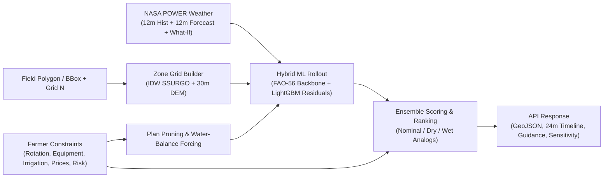

# TerraSense

**Geospatial ML and agronomic decision-support for field-level soil moisture, stress forecasting, and crop-rotation planning.**

TerraSense is a farmer-facing decision-support web application featuring an interactive 2.5D/3D "Civilization-style" parcel viewer. It fuses Earth Observation and soil/terrain datasets with a hybrid physics-and-ML state-transition model to divide a field into micro-management zones, forecast 24-month soil-moisture and evaporative-stress trajectories (12 months historical + 12 months forecast), surface bare-ground and heat/water stress risks, and rank crop-rotation strategies tailored to a farmer's own equipment, rotation history, market prices, and risk tolerance.

---

## Table of Contents

1. [At a Glance](#at-a-glance)
2. [Features](#features)
3. [How It Works](#how-it-works)
4. [Tech Stack & Project Structure](#tech-stack--project-structure)
5. [Data Sources](#data-sources)
6. [The ML Pipeline](#the-ml-pipeline)
7. [Farmer Preferences & Personalization](#farmer-preferences--personalization)
8. [Training & Validation](#training--validation)
9. [API Reference](#api-reference)
10. [Getting Started](#getting-started)
11. [Testing](#testing)
12. [Limitations & Honest Caveats](#limitations--honest-caveats)
13. [Roadmap](#roadmap)
14. [Data & Software Acknowledgments](#data--software-acknowledgments)
15. [License](#license)

---

## At a Glance

- **Who it is for:** Row-crop farmers, agronomists, and land managers evaluating sub-field management zones and next-season crop rotations.
- **What decision it supports:** Which crop-rotation plan (conventional corn–soybean, legume + cover crop, drought-tolerant cash crop, no-till corn + winter rye, or perennial alfalfa) best fits a specific parcel's soil, slope, drainage, local climate, and farm constraints—and where within the field stress or erosion risk is concentrated.
- **Study & calibration domain:** Central Iowa (`bbox: [-94.5, 41.3, -92.8, 42.5]`), calibrated across 305 sampled locations (195 cultivated cropland points) over 2023–2024.

---

## Features

- **Interactive 2.5D/3D Parcel Viewer:** React Three Fiber / Three.js isometric tile grid (`IsoGrid.tsx`) coloring each micro-zone by status (`lush`, `moderate`, `water_stress`, `heat_stress`, `bare_vulnerable`).
- **Configurable Management-Zone Grid:** Divides any bounding box or GeoJSON polygon into an `N × N` grid (`3 ≤ N ≤ 10`, default `6×6 = 36` zones) with IDW-anchored SSURGO/DEM soil and terrain attributes.
- **24-Month Timeline Scrubber:** Seamless 12-month historical baseline + 12-month forecast (`TimelineSlider.tsx`) with autoplay and `P10`/`P90` conformal uncertainty bounds on forecast months.
- **Per-Zone Stress & Risk Indicators:** Detailed zone drawer (`TileDrawer.tsx`) and metrics dashboard (`MetricsDashboard.tsx`) showing SMI, ESI, bare-soil risk, NDVI/vigor proxies, ET, and monthly alerts.
- **Crop-Rotation Strategy Comparison:** Evaluates 3 preset strategies (`status_quo`, `cover_legume`, `drought_cash`) and 2 additional dynamic candidates (`corn_rye_cover`, `alfalfa_perennial`) across nominal, hot/dry, and cool/wet analog weather ensembles (`DecisionPanel.tsx`).
- **Climate What-If Controls:** Interactive temperature shift (`temp_shift` in °C) and precipitation scaling (`precip_factor`) applied to forecast months.
- **Farmer Constraints & Personalization Modal:** Full UI and API support (`ConstraintsModal.tsx`) for previous crop, continuous-corn history, equipment ownership, excluded crops, supplemental irrigation cap/cost, risk aversion, objective weights (including operational simplicity), commodity/nitrogen prices, and uniform vs. zone-variable management.

---

## How It Works



1. **Field & Grid Construction:** `zone_engine.parse_field()` and `build_grid()` discretize the parcel into `N × N` zones, anchoring each zone's soil and terrain (`sand`, `clay`, `som`, `slope`, `awc`, `ph`, `elev_m`, `twi`) via `k=4` Inverse-Distance Weighting over 195 Iowa cropland reference points blended with sub-field spatial variation.
2. **Climate Assembly:** `build_climate()` fetches live or deterministic mock NASA POWER daily weather for the 12 historical months and constructs 12 forecast months blended from climate normals and prior-year analogs, perturbed by `temp_shift` and `precip_factor`.
3. **ML-Driven Monthly Simulation:** `TerraSensePredictor.simulate_vectorized()` runs a batched LightGBM state-transition model on top of a physics water-balance backbone across all zones and 24 months (with optional supplemental irrigation forcing in forecast months).
4. **Pruning, Ensemble Scoring & Ranking:** `crop_plans.py` prunes incompatible plans against slope, drainage, rotation, equipment, and market constraints, scores remaining plans across nominal, dry-analog (`+1.5 °C`, `0.80×` precip), and wet-analog (`-0.8 °C`, `1.20×` precip) weather ensembles, and returns `ranking_sensitivity`, `robust`, and `guidance`.

---

## Tech Stack & Project Structure

- **Frontend:** Next.js `14.2.15` (App Router), React `18.3.1`, TypeScript `5`, Tailwind CSS `3.4`, Lucide Icons, React Icons, React Three Fiber (`@react-three/fiber` `^8.17.0`) / Three.js (`0.169.0`).
- **Backend:** Python, Flask (`>=3.0`), Flask-CORS, NumPy, Pandas, LightGBM (`>=4.3`), XGBoost (`>=2.0`), scikit-learn (`>=1.4`), Rasterio, dbfread, xarray, netCDF4, h5py, joblib, pytest.

```text
TerraSense/
├─ README.md                                  # Consolidated project documentation
├─ RUN_GUIDE.md                               # Quick-start local run guide
├─ LICENSE                                    # Apache License 2.0
└─ terrasense/
   ├─ backend/
   │  ├─ app.py                               # Flask REST API (/api/health, /api/demo-field, /api/field/options, /api/field/analyze, /api/field/timeline)
   │  ├─ nasa_power.py                        # NASA POWER client + deterministic mock + monthly aggregation
   │  ├─ zone_engine.py                       # Grid builder, climate timeline, simulation dispatch, heuristic fallback, guidance
   │  ├─ smoke_test.py                        # Quick end-to-end API sanity check
   │  ├─ fetch_training_data.py               # Offline downloader for NASA POWER, Open-Meteo, SSURGO, SoilGrids
   │  ├─ generate_points.py                   # Generates 305 Iowa sample coordinates (appeears_points.csv)
   │  ├─ appeears_points.csv                  # 305 sample points (5 demo_field_* + 300 train_0001..0300)
   │  ├─ requirements.txt                     # Python dependencies
   │  ├─ ml/
   │  │  ├─ config.py                         # Centralized paths, feature lists, CDL codes, customization defaults & priors
   │  │  ├─ features.py                       # CDL windowing, metric DEM derivatives, SSURGO/SoilGrids fusion, SM->SMI, proxies
   │  │  ├─ build_dataset.py                  # Phase 1 dataset builder -> data/processed/{points_static.csv,training_monthly.csv,schema.json}
   │  │  ├─ train.py                          # Phase 2 hybrid LightGBM trainer + conformal quantiles -> models/
   │  │  ├─ evaluate.py                       # Phase 4 leakage-free spatial/temporal/strict CV + promotion gate
   │  │  ├─ predict.py                        # Phase 5 lazy-loaded singleton predictor & vectorized 24-month rollout
   │  │  ├─ crop_plans.py                     # AgronomicCropPlan definitions, hard-constraint pruning, ensemble scoring
   │  │  ├─ constraints.py                    # Request schema validation (`constraints` / `preferences`) & `/api/field/options`
   │  │  ├─ recon_phase0.py                   # Dataset quality audit script
   │  │  ├─ TRAIN_GUIDE.md                    # Short retraining command reference
   │  │  └─ reports/                          # Phase 0, Phase 1, and Phase 4 JSON/Markdown audit & validation reports
   │  ├─ models/
   │  │  ├─ transition_bundle.joblib          # Trained SMI/ESI LightGBM models, conformal quantiles, reference points
   │  │  └─ manifest.json                     # Model version, schema_hash, monotone constraints, CV benchmarks
   │  └─ tests/
   │     ├─ test_api_contract.py              # Golden API contract & schema tests
   │     ├─ test_phase1_features.py           # Invertible SMI, CDL drop audit, metric DEM, processed dataset checks
   │     ├─ test_phase2_3_ml.py               # Artifact schema, what-if monotonicity sweeps, pruning & scoring
   │     ├─ test_phase4_5_integration.py      # Validation gate, ml/heuristic engine switch, artifact fallback, latency
   │     ├─ test_farmer_customization.py      # Golden snapshot parity, 400 validation, pruning, irrigation, sensitivity
   │     └─ golden_baseline_snapshot.json     # Pre-customization API baseline snapshot
   └─ frontend/
      ├─ package.json                         # Next.js 14 + R3F dependencies (dev server on :3001)
      ├─ app/
      │  ├─ page.tsx                          # Main client state: analysis, timeline, scenario, what-if, constraints
      │  ├─ layout.tsx                        # App layout & metadata
      │  └─ globals.css                       # Tailwind styles
      ├─ components/
      │  ├─ IsoGrid.tsx                       # React Three Fiber 2.5D/3D isometric tile grid
      │  ├─ TimelineSlider.tsx                # 24-month observed/forecast scrubber + playback
      │  ├─ DecisionPanel.tsx                 # Rotation strategy comparison cards & tradeoffs
      │  ├─ TileDrawer.tsx                    # Per-zone soil, moisture, and status inspector
      │  ├─ MetricsDashboard.tsx              # Field-level KPI charts & breakdown
      │  └─ ConstraintsModal.tsx              # Farmer customization & constraints modal
      └─ lib/
         ├─ api.ts                            # Typed fetch wrappers for Flask endpoints
         └─ types.ts                          # TypeScript interfaces mirroring backend API contract
```

---

## Data Sources

All training data covers **305 points** across central Iowa (`bbox: [-94.5, 41.3, -92.8, 42.5]`) in `terrasense/backend/appeears_points.csv` (5 `demo_field_*` points + 300 `train_0001..train_0300` points).

| Dataset | Location (`backend/data/`) | Coverage & Resolution | Variables Used | Role in Pipeline | Status |
|---|---|---|---|---|---|
| **NASA POWER (Inputs)** | `nasa_power/` (305/305 files) | Daily `2023-01-01` – `2024-12-31` (21 unique grid cells) | `PRECTOTCORR`, `T2M_MAX`, `T2M_MIN`, `RH2M`, `ALLSKY_SFC_SW_DWN` | Dynamic weather inputs & Hargreaves PET | Real |
| **NASA POWER (MERRA-2 Targets)** | `nasa_power_targets/` (305/305 files) | Daily `2023-01-01` – `2024-12-31` (~50–60 km, 10 cells) | `GWETTOP`, `GWETROOT`, `GWETPROF`, `EVLAND` | Fallback SMI target (`GWETROOT`) & ET target (`EVLAND`) | Real |
| **ERA5-Land (Open-Meteo)** | `open_meteo/` (182/305 files) | Daily `2023-01-01` – `2024-12-31` (~9 km, 138 unique cells) | `sm_0_7cm`, `sm_7_28cm`, `sm_28_100cm`, `soil_temp_0_7cm`, `et0_mm` | Primary volumetric SMI target (106 cropland pts) & `et0_mm` | Real (123 missing due to earlier HTTP 429 rate limits) |
| **USDA NRCS SSURGO** | `ssurgo/` (305/305 files) | Point mapunit/component/horizon (1,541 horizon rows) | `awc_r`, `claytotal_r`, `sandtotal_r`, `silttotal_r`, `om_r`, `ph1to1h2o_r`, `dbthirdbar_r`, `drainagecl` | Primary static soil profile & Saxton-Rawls $(\theta_{\text{wp}}, \theta_{\text{fc}})$ | Real (5 non-soil/urban points empty) |
| **ISRIC SoilGrids** | `soilgrids/` (189/305 files) | 250 m raster (`0-5`, `5-15`, `15-30 cm`) | `bdod`, `cec`, `clay`, `sand`, `silt`, `soc`, `phh2o` | Secondary soil features (`sg_*`); native NaN handling | Real (116 missing from interrupted fetch; 9 urban/water nulls) |
| **USDA NASS CDL** | `cdl/` (2 GeoTIFFs + `.vat.dbf`) | `2023`, `2024` at 30 m | Crop codes (`1` Corn, `5` Soybeans, `4` Sorghum, `36` Alfalfa, etc.) | Cropland filtering & rotation flags (`corn_soy_rotation`, `continuous_corn`) | Real |
| **SRTM 1-arc-sec DEM** | `earthdata/` (6 GeoTIFF tiles) | Static, 30 m (`N41..N42`, `W093..W095`) | Elevation | Metric terrain derivatives (`slope`, `aspect`, `curvature`, `relief`, `twi`) | Real |
| **MODIS NDVI / ECOSTRESS** | `data/appeears/` (hook ready) | — | `observed_ndvi` | Currently **not present**; `ndvi`, `vigor`, `bare` are computed proxies | Proxy (`is_proxy_ndvi_bare: true`) |

*Note on API `data_sources` labels:* In `ml` mode, `POST /api/field/analyze` reports `soil_moisture: "Hybrid LightGBM + ERA5-Land/SSURGO"` and `evapotranspiration: "Hybrid LightGBM + MERRA-2 EVLAND"`, while `vegetation` remains `"MODIS NDVI (proxy — AppEEARS hook ready)"`. In `heuristic` fallback mode, `soil_moisture` and `evapotranspiration` are labeled as simulated SMAP / ECOSTRESS.

---

## The ML Pipeline

### 1. Dataset Build (`ml/build_dataset.py` & `ml/features.py`)

- **Cropland Filtering:** Coordinates (`EPSG:4326`) are reprojected to `EPSG:5070` (NAD83 / Conus Albers, 30 m) and sampled using a `3×3` (`90 m × 90 m`) majority window. Of the 305 points, **195 (`63.9%`)** survive as cultivated cropland (`kept_cropland`): 157 in Corn–Soybean rotation and 27 in continuous corn. Excluded points are audited in `points_static.csv` (`permanent_pasture_176`: 45, `forest_or_shrubland`: 30, `developed_urban`: 26, `water_or_wetland`: 6, `out_of_cdl_bounds`: 3) with zero silent drops.
- **Terrain Features:** Overlapping DEM tiles are reprojected into a local `15×15` (`450 m × 450 m`, `30 m` pixel) metric patch in `EPSG:5070` **before** computing `elev_m`, `slope_pct`, `slope_mean_90m`, `slope_std_90m`, `aspect_sin`, `aspect_cos`, `curvature`, `local_relief_90m`, `local_relief_210m`, and `twi` (D8 Topographic Wetness Index).
- **Soil Aggregation:** SSURGO components are weighted by `comppct_r` (excluding urban/water/pits) and horizons are thickness-weighted into `0–30 cm` and `30–100 cm` layers plus `awc_100cm_mm` and ordinal `drainage_code` (`1` = very poorly drained to `7` = excessively drained). SoilGrids integer units are divided by `d_factor` (`bdod / 100`, others `/ 10`) and retained as `sg_*` features.
- **Weather Aggregation:** Daily weather is aggregated into 19 monthly features including `gdd_month` (base 10 °C, cap 30 °C), `heat_stress_days` (`tmax >= 32 °C`), `max_dry_spell_days`, `max_5day_precip_mm`, `vpd_kpa`, `pet_mm`, `water_balance_mm`, `aridity_index`, `api_antecedent_mm`, and cyclical `month_sin`/`month_cos`.
- **Output Panel:** `data/processed/training_monthly.csv` contains **4,680 point-month rows** (`195` cropland points × `24` months, `2023-01`..`2024-12`).

### 2. Targets and Derived Indices

| Variable | Type | Definition |
|---|---|---|
| **`smi`** (Soil Moisture Index) | **Learned** | `0–100 cm` depth-weighted ERA5-Land soil moisture (`0.07*sm_0_7 + 0.21*sm_7_28 + 0.72*sm_28_100`) normalized into `[0, 1]` via per-point SSURGO/Saxton-Rawls `(\theta_wp, \theta_fc)` where available (106 points), else MERRA-2 `gwetroot` (89 points). Invertible back to volumetric $\theta$. |
| **`esi`** (Evaporative Stress Index) | **Learned** | Monthly MERRA-2 `evland_mm` (negative winter condensation clipped at `0.0`) divided by reference `et0_mm` (or Hargreaves `pet_mm`), clipped to `[0.05, 1.0]`. |
| **`et_mm`** | **Derived** | `min(demand * esi, sm_wb + infil)` where `demand = pet_mm * kc`. |
| **`bare`** (Bare Soil Risk) | **Documented Proxy** | Deterministic function of `(1 - cover)`, `slope`, `sand`, `rain_intensity`, and `(1 - smi)` in `[0, 1]`. Flagged `is_proxy_ndvi_bare = true`. |
| **`ndvi` / `vigor`** | **Documented Proxy** | Deterministic function of crop `cover`, predicted `esi`, and `smi` in `[0, 1]`. Wired to `load_appeears_ndvi_hook()` for future MODIS data. |
| **`status`** | **Rule-Classified** | Priority order matching `zone_engine.classify()`: `bare >= 0.68` → `bare_vulnerable`; `esi < 0.65` or `smi < 0.30` → `water_stress`; `heat > 0.45` and `esi < 0.9` → `heat_stress`; `vigor > 0.62` → `lush`; otherwise `moderate`. |

### 3. Model Formulation (`ml/train.py` & `ml/predict.py`)

- **Hybrid State-Transition Architecture:** A monthly FAO-56 bucket water-balance step (`wb_smi`, `wb_esi`) provides the physics backbone, and two LightGBM residual models (`smi_model`, `esi_model`, 58 features total) predict state updates conditioned on `prev_state`, `wb_state`, `wb_delta`, weather, crop phenology, and static soil/terrain.
- **Scheduled Sampling:** Training mixes ground-truth and rolled-out predicted `prev_state` across multi-month trajectories to prevent exposure bias during 12-month free-running forecasts.
- **Monotonic Constraints:** Weather and state inputs carry explicit LightGBM directional constraints (`+1` on `prev_state`, `wb_state`, `wb_delta`, `precip_mm`, `water_balance_mm`, `aridity_index`, `api_antecedent_mm`, `rh_pct`; `-1` on `tmax_c`, `tmin_c`, `tmean_c`, `gdd_month`, `heat_stress_days`, `max_dry_spell_days`, `vpd_kpa`, `pet_mm`), guaranteeing physically consistent `temp_shift` and `precip_factor` what-if responses.
- **24-Month Unified Rollout:** Historical months (`0..11`) and forecast months (`12..23`) execute through the same transition function. History always uses `status_quo`; forecast months apply the selected `scenario`, climate shifts (`temp_shift`, `precip_factor`), and optional supplemental irrigation.
- **Conformal Uncertainty Bands:** Out-of-fold conformal residual quantiles (`q10`, `q50`, `q90`) are stored per forecast horizon (`h = 1..12`) in `manifest.json` and attached as `uncertainty: {smi_p10, smi_p90, esi_p10, esi_p90}` on forecast months.

### 4. Engine Selection, Artifacts & Fallback

- Controlled by `TERRASENSE_ENGINE` (`auto` [default], `ml`, `heuristic`).
- On startup/first call, `TerraSensePredictor` (`ml/predict.py`) validates `models/transition_bundle.joblib` against `models/manifest.json` using a 12-char SHA-256 `schema_hash` of `TRANSITION_FEATURE_COLS`.
- If artifacts are missing, corrupted, or fail schema validation, `get_predictor()` logs a warning and automatically falls back to `zone_engine.simulate_heuristic()`.

---

## Farmer Preferences & Personalization

> **Important Design Boundary:** The trained ML model predicts physical soil moisture and evaporative stress and is **not retrained per farmer**. Farmer `constraints` and `preferences` operate strictly on **plan pruning, supplemental irrigation forcing, and the multi-objective scoring/ranking layer**. Commodity prices, custom-hire rates, and plan yield/N-fixation effects are documented agronomic priors (ISU Extension Files A1-20, A3-10, PM 1688; FAO-56/33), not ML-learned parameters.

| Option (`constraints.*`) | Type / Values | Default | Effect |
|---|---|---|---|
| `prev_crop` | Crop name (`corn`, `soybean`, `sorghum`, `alfalfa`, etc.) or CDL code | `"corn"` (`1`) | Enforces rotation rules (e.g., prunes `cover_legume` after soybean; prunes `corn_rye_cover` after corn). |
| `continuous_corn_years` | `int` in `[0, 10]` | `1` (if corn) / `0` | Prunes corn-on-corn (`status_quo`) when `>= max_continuous_corn_years` (default `2`). |
| `equipment` | `{has_hay_baler, has_cover_drill, has_no_till_drill, variable_rate}` | All `true` | Prunes plans requiring missing drills; keeps `alfalfa_perennial` without a baler via `+$115/ha` custom-hire surcharge when `allow_custom_hire=true`. |
| `excluded_crops` | List of crop names or CDL codes | `[]` | Prunes any plan using excluded crops (e.g., no local sorghum buyer). |
| `irrigation_cap_mm` | `float` in `[0, 600]` mm/season | `0.0` (rainfed) | Adds supplemental water during Jun–Aug when zone SMI `< 0.68`; clips states to training range `[0.02, 0.94]` and sets `extrapolated: true`. |
| `irrigation_cost_usd_per_mm` | `float` in `[0, 5]` USD/mm/ha | `0.45` | Deducts pumping cost (`irrigation_applied_mm * cost`) from plan margin. |
| `risk_aversion` | `"conservative"` (`0.50`), `"balanced"` (`0.25`), `"aggressive"` (`0.05`), or `float` in `[0, 1]` | `"balanced"` (`0.25`) | Sets $\lambda$ in risk-adjusted utility: $\text{Mean Utility} - \lambda \cdot \text{Downside Deviation}_{\text{dry}}$. |
| `weights` / `priority` | `water_saving`, `income`, `soil_restoration`, `simplicity` | Equal 1/3 (`simplicity: 0`) | Normalized to sum to `1.0`. `simplicity` penalizes `extra_field_passes` (`0` for row crops, `2` for cover crops, `4` for multi-cut hay). |
| `prices` | `corn_usd_bu`, `soybean_usd_bu`, `sorghum_usd_bu`, `alfalfa_usd_ton`, `nitrogen_price_usd_kg` | ISU File A1-20 baselines | Scales crop gross margins and N-fixation credits (`75 kg N/ha` for `cover_legume`, `140 kg N/ha` for `alfalfa_perennial`). |
| `management_mode` | `"uniform"` or `"zone_variable"` | `"zone_variable"` | `"uniform"` assigns the top field-wide plan to all zones; `"zone_variable"` assigns per-zone winners (falls back to `"uniform"` with a warning if `variable_rate=false`). |

- **Over-constrained fallback:** If every plan violates at least one constraint, `prune_candidate_plans_detailed()` returns the least-violating plan(s) flagged `constraint_violation: true` instead of an empty list or 500 error.
- **Robustness & Sensitivity:** Each analysis compares the customized winner against default settings (`ranking_sensitivity.decisive_settings`) and sets `robust: false` with a `robust_reason` whenever the Rank 1 vs. Rank 2 score margin is smaller than `max(0.03, 0.5 * weather_ensemble_spread)`.

---

## Training & Validation

### Retraining Commands

From `terrasense/backend/`:

```bash
# 1. Rebuild processed features & monthly training table
.venv/bin/python -m ml.build_dataset

# 2. Retrain LightGBM transition models, conformal quantiles, bundle & manifest
.venv/bin/python -m ml.train

# 3. Run leakage-free spatio-temporal validation & promotion gate
.venv/bin/python -m ml.evaluate
```

*(Restart `app.py` after retraining so `ml/predict.py` reloads `transition_bundle.joblib` and `manifest.json`.)*

### Leakage-Free Validation Design (`ml/evaluate.py`)

1. **Buffered Spatial Cluster CV:** 5-fold spatial cluster split enforcing a **$\ge 25\text{ km}$ Haversine exclusion buffer** around test points and **zero shared ERA5-Land grid cells** between train and test.
2. **Temporal Cross-Validation:** Train on 2023 → 12-month free-running rollout on 2024, and Train on 2024 → 12-month rollout on 2023.
3. **Strictest Leave-Cluster-AND-Year-Out Split:** Train only on buffered spatial clusters ($\ge 25\text{ km}$) in 2023 and evaluate 12-month rollouts on unseen spatial clusters in 2024.
4. **Promotion Gate:** ML becomes the default engine (`gate_passed: true`) only if it achieves positive MSE skill over **all three baselines** (Persistence, Per-Month Climatology, and the Heuristic FAO-56 engine) on both SMI and ESI in the strictest split, plus positive skill over Climatology in Buffered Spatial CV.

### Validation Results (`ml/reports/validation_report.md`)

**Promotion Gate Passed:** `True` (Recommended default engine: `ml`)

| Validation Split | Target | ML RMSE | Heuristic RMSE | Climatology RMSE | Persistence RMSE | ML $R^2$ | Spearman $r$ | Skill vs. Clim | Skill vs. Heur | 80% Cov |
|---|---|---:|---:|---:|---:|---:|---:|---:|---:|---:|
| Buffered Spatial CV ($\ge 25\text{ km}$) | **SMI** | **0.1415** | 0.2755 | 0.1854 | 0.2069 | 0.3878 | 0.6372 | `+41.7%` | `+73.6%` | `79.9%` |
| Buffered Spatial CV ($\ge 25\text{ km}$) | **ESI** | **0.1275** | 0.3366 | 0.1811 | 0.3978 | 0.7391 | 0.8787 | `+50.4%` | `+85.6%` | `70.4%` |
| Temporal (2023↔2024) | **SMI** | **0.1474** | 0.2968 | 0.2157 | 0.1957 | 0.3899 | 0.6416 | `+53.3%` | `+75.3%` | `75.4%` |
| Temporal (2023↔2024) | **ESI** | **0.1581** | 0.3323 | 0.2562 | 0.3198 | 0.5603 | 0.7998 | `+61.9%` | `+77.3%` | `44.2%` |
| Strictest: Cluster ($\ge 25\text{ km}$) + Year Out | **SMI** | **0.1739** | 0.2755 | 0.2245 | 0.2069 | 0.0750 | 0.4937 | `+40.0%` | `+60.1%` | `70.6%` |
| Strictest: Cluster ($\ge 25\text{ km}$) + Year Out | **ESI** | **0.1955** | 0.3366 | 0.2547 | 0.3978 | 0.3871 | 0.6765 | `+41.1%` | `+66.3%` | `40.4%` |

**5-Class Zone Status Classification (`lush`, `moderate`, `water_stress`, `heat_stress`, `bare_vulnerable`):**

| Validation Split | ML Macro-F1 | Heuristic Macro-F1 | ML Accuracy | Heuristic Accuracy |
|---|---:|---:|---:|---:|
| Buffered Spatial CV ($\ge 25\text{ km}$) | **0.8472** | 0.7071 | **84.3%** | 68.5% |
| Temporal Combined | **0.7649** | 0.6931 | **75.8%** | 66.0% |
| Strictest: Cluster + Year Out | **0.7157** | 0.7071 | **67.8%** | 68.5% |

---

## API Reference

All endpoints are served by Flask on `http://localhost:5001` (proxied by Next.js `/api/*`).

| Endpoint | Method | Purpose |
|---|---|---|
| `/api/health` | `GET` | Service status, `live_nasa` flag, active `engine` (`ml`/`heuristic`), `model_version` |
| `/api/demo-field` | `GET` | Default demo central Iowa parcel bbox, `grid_size: 6`, and default preferences |
| `/api/field/options` | `GET` | Full schema of supported farmer `constraints`, valid crops/CDL codes, ranges, units, presets, and defaults |
| `/api/field/analyze` | `POST` | Build zone grid, run ensemble crop-plan evaluation, return GeoJSON, scenarios, guidance, and customization diagnostics |
| `/api/field/timeline` | `GET` | Return 24-month trajectory (`12` historical + `12` forecast) for a `field_id` and `scenario` |

### `POST /api/field/analyze`

**Request Body (all fields optional):**
```jsonc
{
  "field": { "bbox": [-93.6045, 41.5955, -93.5955, 41.6045] }, // or { "polygon": GeoJSON Polygon | ring }
  "grid_size": 6,                                                // int in [3, 10]
  "date_range": { "end": "2024-11" },                            // anchor month ("YYYY-MM"); defaults to 2024-11
  "preferences": { "priority": "soil_restoration" },             // legacy priority or weights (overridden if constraints sent)
  "climate": { "temp_shift": 0, "precip_factor": 1.0 },          // forecast what-if perturbation
  "use_live": false,                                             // live NASA POWER fetch (falls back to mock)
  "constraints": {                                               // optional additive farmer customization object
    "prev_crop": "soybean",                                      // crop name or CDL code
    "continuous_corn_years": 1,
    "equipment": {
      "has_hay_baler": false,
      "has_cover_drill": true,
      "has_no_till_drill": true,
      "variable_rate": true
    },
    "allow_custom_hire": true,
    "excluded_crops": ["sorghum"],
    "irrigation_cap_mm": 80,
    "irrigation_cost_usd_per_mm": 0.45,
    "risk_aversion": "conservative",                             // "conservative" | "balanced" | "aggressive" | float [0,1]
    "weights": { "water_saving": 0.25, "income": 0.35, "soil_restoration": 0.25, "simplicity": 0.15 },
    "prices": { "corn_usd_bu": 5.20, "nitrogen_price_usd_kg": 1.60 },
    "management_mode": "zone_variable"                           // "uniform" | "zone_variable"
  }
}
```

**Response (`200 OK`, trimmed):**
- **Core contract keys:** `field_id`, `generated_at`, `engine`, `model_version`, `is_proxy_ndvi_bare`, `data_sources`, `grid`, `bbox`, `field_geojson` (`1` boundary + `n_zones` zone features with `soil`, `current`, `recommended_scenario`), `summary`, `scenarios[3]` (with `metrics`, `score_breakdown`, `planting_window`, `tradeoffs`), `recommended_scenario`, `preference_weights`, `guidance` (`seed_window`, `vulnerable_windows[]`, `cover_crop_windows[]`, `stress_alerts[]`).
- **Additive customization & uncertainty keys:** `ranking_robust`, `robust`, `robust_reason`, `uncertainty_note`, `dynamic_candidates` (all 5 plans with `feasible`, `pruned_reason`, `constraint_violation`, `custom_hire_cost_usd_ha`), `pruned_plans`, `constraint_violation`, `ranking_sensitivity`, `management_mode`, `applied_constraints`, `warnings`, `extrapolated`, `extrapolation_note`.
- **Validation errors (`400 Bad Request`):** Returns `{"error": "...", "field": "<field_name>"}` for invalid types, out-of-range numbers, negative/all-zero weights, or unknown crops. Unknown extra keys append to `warnings` without failing.

### `GET /api/field/timeline`

Query params: `field_id` (required, `404` if unknown), `scenario` (`status_quo` | `cover_legume` | `drought_cash`, `400` otherwise), `temp_shift`, `precip_factor`, `irrigation_cap_mm` (optional override; defaults to stored field constraint).

Returns `field_id`, `scenario`, `anchor_index` (`11`), `engine`, `model_version`, `is_proxy_ndvi_bare`, `months[24]` (`index` `0..11` `"historical"` identical across scenarios; `12..23` `"forecast"` with `uncertainty` P10/P90 bounds), `guidance`, and (when irrigated) `irrigation_applied_mm`, `extrapolated`, `extrapolation_note`.

---

## Getting Started

### Prerequisites

- Python `3.10+` (verified on Python `3.13.5`)
- Node.js `18+` and `npm`

### 1. Backend Setup (`http://localhost:5001`)

```bash
cd terrasense/backend
python3 -m venv .venv
source .venv/bin/activate
pip install -r requirements.txt
python app.py
```

No external API keys are required: NASA POWER defaults to deterministic mock normals and switches to live fetching with `TERRASENSE_LIVE=1 python app.py` (with automatic mock fallback).

### 2. Frontend Setup (`http://localhost:3001`)

```bash
cd terrasense/frontend
npm install
npm run dev
```

Open `http://localhost:3001` in your browser (`/api/*` requests are proxied to Flask on `:5001`).

### Environment Variables

| Variable | Values | Default | Effect |
|---|---|---|---|
| `TERRASENSE_ENGINE` | `auto`, `ml`, `heuristic` | `auto` | Forces ML (`ml`), forces heuristic (`heuristic`), or uses ML with heuristic fallback (`auto`). |
| `TERRASENSE_LIVE` | `0`, `1` | `0` | Enables live NASA POWER API requests (with mock fallback on error). |
| `PORT` | Integer port | `5001` | Flask listen port. |

---

## Testing

Run the full backend test suite from `terrasense/backend/`:

```bash
.venv/bin/pytest tests -v
```

| Test File | Coverage |
|---|---|
| `tests/test_api_contract.py` | Endpoint status codes, GeoJSON topology, finite bounds, chronological 24-month timelines, historical invariance across scenarios, 400/404 validation |
| `tests/test_phase1_features.py` | Invertible SM $\leftrightarrow$ SMI transform, CDL keep/drop audit across all 305 points, metric DEM terrain math, proxy bounds, processed CSV integrity |
| `tests/test_phase2_3_ml.py` | `transition_bundle.joblib` & `manifest.json` schema hash, climate what-if monotonicity (`temp_shift`, `precip_factor`), crop plan pruning & ensemble scoring |
| `tests/test_phase4_5_integration.py` | Phase 4 promotion gate verification, `TERRASENSE_ENGINE` `ml` vs. `heuristic` switching, missing/corrupted artifact fallback, vectorized 6×6 latency (`~53 ms`) |
| `tests/test_farmer_customization.py` | Golden baseline snapshot parity (`golden_baseline_snapshot.json`), HTTP 400 field-level validation & warnings, rotation/equipment/exclusion pruning & over-constrained fallback, risk aversion/N-price/simplicity scoring, irrigation monotonicity & `[0.02, 0.94]` clipping, `uniform` vs. `zone_variable` modes, `/api/field/options` |

Optional quick live-server sanity check: `python smoke_test.py` (while `app.py` is running).

---

## Limitations & Honest Caveats

- **Short Historical Record (2023–2024):** Training covers 24 months (`2023` drought vs. `2024` wetter spring/summer), which limits generalization compared to a multi-decade climate record—reflected in lower `R^2` (`0.0750` SMI) and narrower 80% ESI conformal coverage (`40.4%`) on the strictest unseen-year+cluster split.
- **Coarse-Resolution Targets:** `target_smi_era5` (~9 km, 106 points) and `target_smi_merra2` / `target_esi` (~50–60 km, 195 points) are regional reanalysis products; sub-field 30 m zone differentiation is driven by SSURGO soil profiles, metric DEM terrain, and the FAO-56 water-balance backbone.
- **No Real MODIS NDVI or ECOSTRESS Yet:** `ndvi`, `vigor`, and `bare` are documented deterministic proxies (`is_proxy_ndvi_bare: true`) computed from predicted `(smi, esi)` and crop cover schedules rather than trained on satellite vegetation/ET retrievals.
- **Agronomic Priors vs. Learned Counterfactuals:** Cover-crop termination effects, sorghum substitution, nitrogen fixation credits, custom-hire surcharges, and crop enterprise margins are literature-backed agronomic priors (ISU Extension, FAO-56/33, USDA-NRCS), not randomized field-trial counterfactuals.
- **Irrigation Extrapolation:** The ML model was trained on predominantly rainfed Iowa parcels; when `irrigation_cap_mm > 0`, irrigated soil-moisture states are clipped to `[0.02, 0.94]` and responses explicitly return `extrapolated: true`.

---

## Roadmap

- Extend historical weather/reanalysis training coverage to **2015–2024** (`python fetch_training_data.py --sources power power_targets open_meteo --start 2015-01-01 --end 2024-12-31`) and backfill the 123 rate-limited Open-Meteo ERA5-Land points.
- Ingest real **MODIS NDVI** and **ECOSTRESS** granules via AppEEARS into `data/appeears/` to activate `load_appeears_ndvi_hook()` and replace proxy vegetation indices.
- Add persistent field/session storage (PostGIS / Redis) in place of the in-memory `FIELDS` and `_TL_CACHE` dictionaries in `app.py`.

---

## Data & Software Acknowledgments

- **NASA POWER** (Prediction Of Worldwide Energy Resources) & **MERRA-2** reanalysis (`GWET*`, `EVLAND`).
- **ECMWF ERA5-Land** hourly/daily reanalysis accessed via **Open-Meteo**.
- **USDA NRCS SSURGO** (Soil Survey Geographic Database) & **ISRIC SoilGrids** (250 m global gridded soil information, CC-BY 4.0).
- **USDA NASS Cropland Data Layer (CDL)** (30 m annual crop-specific land cover).
- **NASA SRTM** 1-arc-second Digital Elevation Model tiles (`earthdata/`).
- Built with **LightGBM**, **scikit-learn**, **Rasterio**, **Flask**, **Next.js**, and **React Three Fiber / Three.js**.

---

## License

Licensed under the [Apache License 2.0](LICENSE).
